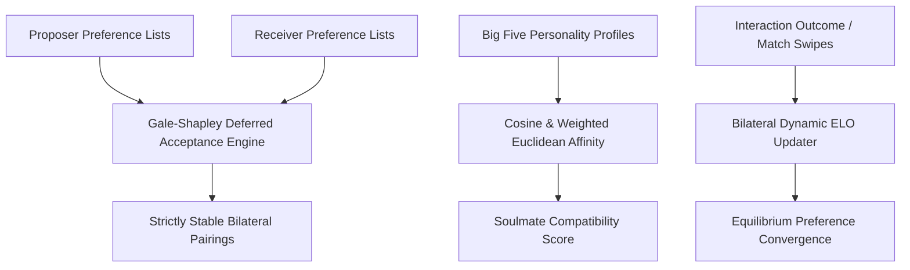

# genpark-cyber-dating


GenPark Cyber Dating is a zero-dependency algorithmic matchmaking and partner recommendation engine implementing the Nobel-prize-winning Gale-Shapley Deferred Acceptance stable matching algorithm, Big Five personality trait vector cosine affinity modeling, and bilateral dynamic ELO ratings.



## Features
- **Gale-Shapley Stable Matching**: Guarantees zero blocking pairs and Pareto optimality across multi-agent pairing rosters.
- **Big Five Trait Vector Affinity**: Measures cosine similarity and weighted Euclidean distance across Ocean personality dimensions.
- **Bilateral ELO Rating System**: Computes expected preference probability and adapts agent desirability ratings dynamically.

## Quickstart

```python
from client import GenParkCyberDating

dating = GenParkCyberDating()
res = dating.solve_gale_shapley_stable_matching(
    {"A": ["X", "Y"], "B": ["Y", "X"]},
    {"X": ["B", "A"], "Y": ["A", "B"]}
)
print("Matches:", res["matched_pairs"])
```

## License
MIT
